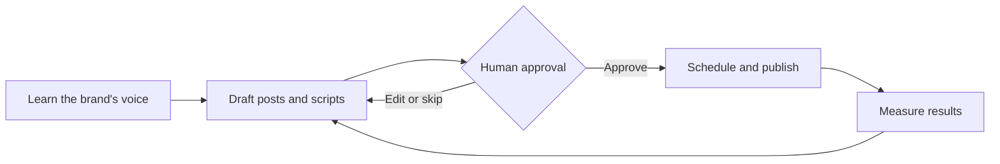

# AI Content Engine

**An AI content system for small businesses and creators: it writes in each brand's voice, and a person approves everything before it goes out.**

> This is a product overview. The source code is private because the engine is used with clients.

---

## The problem

Small businesses know they should post consistently on every platform, but most don't have the time or a team to do it. Fully automated tools fill the gap with generic posts that don't sound like the brand, and they publish without anyone checking.

## What it does

1. **Learns the brand's voice** from content the business has already written
2. **Drafts posts and scripts** tailored to each platform
3. **Waits for approval.** The business approves, edits, or skips every piece
4. **Schedules and publishes** across platforms
5. **Measures results** and feeds what works back into the next round of drafts

## Design principles

- **A person stays in control.** Nothing goes out without approval, and sensitive uses such as a person's voice or likeness require explicit sign-off.
- **Costs stay predictable.** Built-in spending limits keep AI usage within budget.
- **Each client's data stays separate.** One business can never see another's content.
- **Every release is tested.** Automated tests run before every change ships.

## Where it started

I first built a version of this to run an online faith community I founded. That community grew from 0 to 38,000+ members on Threads in 14 months and published 9,849 posts, all while I was competing as an NCAA Division I athlete. The engine turns that one-off system into a product other businesses can use.

## Built with

Python · Claude (Anthropic) · Claude Code

---

**Kiersten Lee** · Atlanta, GA · [LinkedIn](https://linkedin.com/in/kierstenjlee) · [Portfolio](https://licketysnicketty222.github.io)
